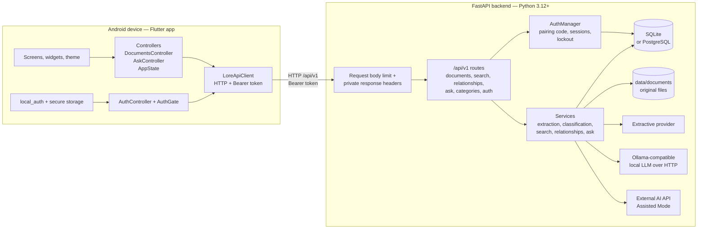
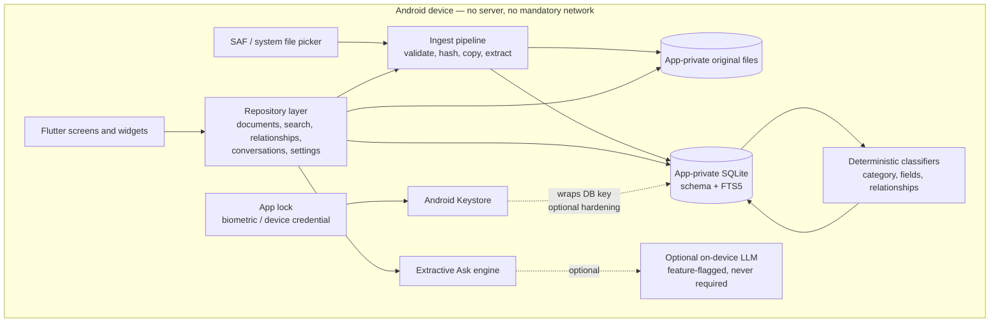
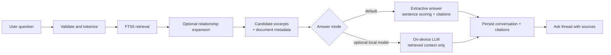

# LORE Phase 3.0 — Local-First Architecture Audit

**Audit type:** Read-only architecture and migration audit  
**Date:** 2026-11-03  
**Repository:** `D:\Dishanth-Project\Lore`  
**Flutter application:** `D:\Dishanth-Project\Lore\mobile`  
**Branch:** `main` (tracking `origin/main`)  
**HEAD at audit time:** `4a16e9516685cee03cdbc659fb246e1c6b0847d8`  
**Target platform:** Android only  
**Target product shape:** Local-first, offline-capable, single-device, no FastAPI, no remote database, no cloud storage, no mandatory internet, no accounts/login, no external AI services

---

## Evidence labels used in this report

Every material finding is labeled with exactly one of the following:

- **Verified in source code** — directly observed in the working tree at the audit commit, including uncommitted and untracked files.
- **Inferred from implementation** — a conclusion drawn from how the verified code behaves, not a line-by-line fact.
- **Proposed design** — a recommendation authored by this audit; not implemented.
- **Requires prototype or validation** — plausible but dependent on device, library, performance, licensing, or build verification.

The audit inspected the working tree, not only the last commit. The repository contains 19 tracked modifications and 19 untracked files at audit time. All statements about current behavior refer to that working tree.

**Read-only guarantee:** this audit created exactly one file, this report. No source, configuration, database, document, migration, dependency, or Git state was changed. No migration, package installation, commit, push, reset, checkout, or stash was executed.

---

# 1. Executive summary

LORE currently delivers a complete server-backed document library: the Android Flutter app is a client for a FastAPI service that stores originals, extracts text, classifies documents, builds a search index, computes relationships, and answers questions. **Verified in source code:** the Flutter app has no local database, no local document store, no local search, no local extraction, and no persisted Ask history. Its only data source is `LoreApiClient` over HTTP ([mobile/lib/data/api_client.dart](mobile/lib/data/api_client.dart)).

The local-first target is feasible without discarding most of the product. The Flutter presentation layer, theming, navigation, document cards, viewer, and import picker are largely reusable. The deterministic backend logic — filename and signature validation, PDF/TXT text extraction, the 11-category classifier, FTS5 search, relationship scoring, and extractive question answering — is portable to Dart and/or Android-native libraries. **Inferred from implementation:** the core product does not inherently require a server; it currently inherits one because storage, indexing, and AI execution were placed there.

The two genuinely difficult areas are:

1. **On-device AI.** The current local-LLM path is an HTTP call to an Ollama-compatible server ([app/services/ask.py](app/services/ask.py)). Replacing it with a bundled on-device model raises RAM, thermal, model-licensing, and device-coverage questions. **Requires prototype or validation.** The deterministic extractive provider is the safer v1 answer engine.
2. **OCR and PDF text extraction.** Server-side extraction uses PyMuPDF and optional Tesseract. Flutter has PDF rendering via `pdfrx`, but text extraction and robust OCR need a validated local implementation. **Requires prototype or validation.**

**Recommendation:** adopt a staged local-first architecture with SQLite/FTS5 and app-private file storage as the foundation. Ship v1 with deterministic extraction, classification, search, relationships, and extractive Ask. Treat on-device LLM as an explicit, optional later capability, never a dependency. Remove pairing, sessions, accounts, invitations, and the HTTP client at the cutover, and remove the `INTERNET` permission from the release manifest.

**Executive capability matrix**

| Capability | Current location | Local-first disposition | Difficulty | Confidence |
|---|---|---|---|---|
| Document metadata | Server SQLite/PostgreSQL | Local SQLite | Low | High |
| Original files | Server `data/documents` | Android app-private storage | Low | High |
| PDF/TXT extraction | PyMuPDF / UTF-8 decode | PDFium/Android-native + Dart | Medium–High | Medium |
| OCR | Optional Tesseract | ML Kit or equivalent | High | Medium |
| Classification | Python rules | Dart port | Low–Medium | High |
| Full-text search | FTS5 / PostgreSQL FTS | Local FTS5 | Low | High |
| Relationships | Python heuristics | Dart port | Low | High |
| Extractive Ask | Python | Dart port | Medium | High |
| Local LLM Ask | Ollama HTTP | Optional on-device model | High | Low |
| External AI | Server HTTP provider | Remove | Low | High |
| Pairing / sessions | Server | Remove; use local app lock | Low | High |
| Accounts / invitations | Server | Remove | Low | High |

**Overall verdict:** proceed, but do not begin Phase 3.1 until this report is approved. The first milestone should prove local storage and FTS5 on a real Android device before any screen is rewired.

---

# 2. Current architecture diagram

## 2.1 Runtime topology



**Verified in source code:**

- App composition instantiates `LoreApiClient`, `AppState`, `DocumentsController`, `AskController`, and `AuthController`, and gates the shell behind `AuthGate` ([mobile/lib/app.dart](mobile/lib/app.dart), [mobile/lib/screens/auth_gate.dart](mobile/lib/screens/auth_gate.dart)).
- The API base URL is compile-time configured, with a debug default of `http://10.0.2.2:8000` and the `/api/v1` prefix ([mobile/lib/core/api_config.dart](mobile/lib/core/api_config.dart)).
- Every data operation is an HTTP call: list, upload, download, delete, search, classify, organize, relationships, Ask, system status, and auth ([mobile/lib/data/api_client.dart](mobile/lib/data/api_client.dart)).
- FastAPI stores originals under the configured data directory and metadata in SQLAlchemy-managed SQLite or PostgreSQL ([app/services/documents.py](app/services/documents.py), [app/db/session.py](app/db/session.py)).
- Startup verifies that the database schema revision matches the Alembic head and refuses to auto-migrate ([app/db/schema.py](app/db/schema.py), [app/main.py](app/main.py)).
- SQLite uses an FTS5 virtual table; PostgreSQL uses a weighted `tsvector` with GIN and `ts_headline` ([app/services/search_sqlite.py](app/services/search_sqlite.py), [app/services/search_postgres.py](app/services/search_postgres.py)).
- Ask supports three providers: deterministic extractive, Ollama-compatible local LLM over HTTP, and an external AI provider gated by Assisted Mode prepare/confirm consent ([app/services/ask.py](app/services/ask.py), [app/api/v1/ask.py](app/api/v1/ask.py)).
- Pairing uses a code file on the server; sessions are bearer tokens stored as SHA-256 digests; failed pairing attempts are persisted with exponential lockout ([app/services/auth.py](app/services/auth.py), [app/models/auth.py](app/models/auth.py)).
- Account and invitation tables and services exist, but there is no registered HTTP login or invitation-redemption route ([app/services/accounts.py](app/services/accounts.py), [app/api/v1/auth.py](app/api/v1/auth.py), [app/api/router.py](app/api/router.py)).

## 2.2 Current request flows

**Import flow — Verified in source code**

1. User selects one or more files with `file_picker` ([mobile/lib/screens/import_documents_screen.dart](mobile/lib/screens/import_documents_screen.dart)).
2. `DocumentsController` reads each file and uploads it sequentially through `LoreApiClient`.
3. FastAPI enforces a body cap with a spooled temporary file, validates the content signature, sanitizes the filename, checks SHA-256 for duplicates, and writes atomically ([app/api/middleware.py](app/api/middleware.py), [app/services/documents.py](app/services/documents.py)).
4. Text is extracted server-side; classification, organization fields, and search indexing follow.
5. The response returns the document DTO; the app reloads its list from the server.

**Ask flow — Verified in source code**

1. The app posts a question to `/api/v1/ask` or `/api/v1/documents/{id}/ask`.
2. The backend retrieves candidate documents from search or recent documents.
3. Extractive mode builds an answer from sentences with citations. Local-LLM mode sends excerpts to an Ollama-compatible endpoint. Assisted mode prepares excerpts, requires explicit confirmation, then calls an external provider.
4. The app keeps the resulting conversation in memory only; `AskController` clears it when the session closes ([mobile/lib/state/ask_controller.dart](mobile/lib/state/ask_controller.dart)).

**Offline behavior — Verified in source code**

The shell can display an offline banner when the health check fails, but the document library, search, import, viewer, Ask, settings actions, and auth all depend on the backend. **Inferred from implementation:** with the server stopped, LORE has no usable document workflow; the app is not offline-capable today.

## 2.3 Current data inventory

| Item | Path | Size / count | Evidence |
|---|---|---|---|
| Live database | `data/lore.db` | 98,304 bytes, SHA-256 `3223c49416484cd0226ba414dd5fe449eedbb2f2ec5e0ef9de1abef10d75b25e` | Verified in source code |
| Original document | `data/documents/1646d9ff-ef2c-4dc9-b2fd-48b61c079b4a.pdf` | 601 bytes | Verified in source code |
| Pairing code | `data/pairing-code.txt` | 94 bytes | Verified in source code |
| Document count | Database | 1 | Verified in source code |

The live database was not opened for writing. Its hash was recorded before and after this audit and is unchanged.

---

# 3. Target architecture diagram

## 3.1 Target topology



## 3.2 Target principles

| Principle | Consequence | Label |
|---|---|---|
| Device is the system of record | SQLite plus app-private files are authoritative; no remote copy is required | Proposed design |
| Offline by default | Import, extraction, search, relationships, and Ask work in airplane mode | Proposed design |
| Single owner, no accounts | Remove users, invitations, sessions, pairing, and login from the runtime | Proposed design |
| Deterministic before generative | Classification, relationships, and extractive Ask work without an LLM | Proposed design |
| Least privilege | Release build has no `INTERNET` permission; no analytics; no cloud SDKs | Proposed design |
| User-controlled data movement | Export/import and optional model files use SAF and explicit user action | Proposed design |
| Reversibility | Existing server data can be exported and imported once; no vendor lock-in | Proposed design |
| Measured migration | Each milestone preserves a working app path until parity, then removes the server path | Proposed design |

## 3.3 Target component responsibilities

| Component | Responsibility | Current counterpart | Disposition |
|---|---|---|---|
| `LoreDatabase` (Drift) | Schema, migrations, queries, FTS5 access | SQLAlchemy + Alembic | Dart-reimplementable |
| `DocumentFileStore` | App-private originals, atomic writes, SHA-256 | `data/documents` + server file service | Dart-reimplementable |
| `IngestService` | Validate, hash, copy, extract, classify, index | Upload endpoint + document service | Dart-reimplementable |
| `ExtractionService` | PDF/TXT text, optional OCR | PyMuPDF + pytesseract | Android-native-library |
| `ClassificationService` | 11 categories, document type, issuer, reference, date, tags | `app/services/organization.py` | Dart-reimplementable |
| `SearchRepository` | Query validation, FTS5 match, bm25, snippets | `app/services/search_common.py` + providers | Retained SQLite operation |
| `RelationshipService` | Candidate scoring, stable pair IDs, evidence | `app/services/relationships.py` | Dart-reimplementable |
| `AskService` | Retrieval, extractive answer, citations, optional LLM | `app/services/ask.py` | Dart-reimplementable + on-device AI replacement |
| `AppLockService` | Biometric/PIN gate, auto-lock, lifecycle | `AuthController` + `local_auth` | Reuse with adaptation |
| `SettingsRepository` | AI mode, lock timeout, privacy options | Backend settings + `AppState` | Dart-reimplementable |

---

# 4. Flutter feature inventory

## 4.1 Classification scheme

| Class | Meaning | Migration action |
|---|---|---|
| **A** | Reusable unchanged | Keep the file and public API; adjust imports only if needed |
| **B** | Reusable with adaptation | Retain UI/UX and structure; replace the data source, navigation guard, or platform call |
| **C** | Reimplement on-device | The user-facing feature remains, but the logic currently executed by FastAPI must be rebuilt in Dart or an Android library |
| **D** | Retire | Server-only concern with no place in the local-first product |

Mixed features are split into separate rows so every row has one class.

## 4.2 Feature inventory

| # | Feature | Primary source | Class | Notes | Evidence |
|---|---|---|---|---|---|
| 1 | Theme, typography, colors | `mobile/lib/core/theme.dart`, `document_style.dart` | **A** | Pure presentation | Verified in source code |
| 2 | Formatting and error text | `mobile/lib/core/formatting.dart`, `error_text.dart` | **A** | Pure Dart helpers; some error strings mention the backend and need wording updates later | Verified in source code |
| 3 | Shared widgets, document card, category chip, citations | `mobile/lib/widgets/*` | **A** | Presentation and formatting only | Verified in source code |
| 4 | App shell, four tabs, offline banner | `mobile/lib/screens/app_shell.dart` | **B** | Keep navigation; replace backend-health banner with local readiness/status | Verified in source code |
| 5 | Home screen | `mobile/lib/screens/home_screen.dart` | **B** | Recent documents, quick tiles, privacy note remain; data source changes to local repository | Verified in source code |
| 6 | Documents list UI | `mobile/lib/screens/documents_screen.dart` | **B** | Search field, category pills, empty/error/loading states remain | Verified in source code |
| 7 | Search interaction and debounce | `mobile/lib/state/documents_controller.dart` | **B** | UI behavior remains; query execution moves to local FTS5 | Verified in source code |
| 8 | Document pagination and category filtering | `mobile/lib/state/documents_controller.dart` | **B** | Replace HTTP pagination with local queries; preserve 100-per-page behavior if desired | Verified in source code |
| 9 | Import picker and multi-select | `mobile/lib/screens/import_documents_screen.dart` | **B** | `file_picker` already operates on local files; replace upload with local ingest | Verified in source code |
| 10 | Upload orchestration and duplicate handling | `mobile/lib/state/documents_controller.dart`, `LoreApiClient.uploadDocument` | **C** | Rebuild as local hash/copy/transaction flow | Verified in source code |
| 11 | Document detail UI and actions | `mobile/lib/screens/document_detail_screen.dart` | **B** | Open, Ask, connections, reclassify, retry, edit, delete remain; handlers re-point locally | Verified in source code |
| 12 | Original viewer | `mobile/lib/screens/document_viewer_screen.dart` | **B** | Already renders PDF with `pdfrx`, images with `Image.memory`, text with `SelectableText`; replace download with local file read | Verified in source code |
| 13 | Ask screen UI and suggestions | `mobile/lib/screens/ask_screen.dart` | **B** | Thread UI, suggestions, privacy indicator, approval UI remain | Verified in source code |
| 14 | Ask conversation state | `mobile/lib/state/ask_controller.dart` | **C** | Currently in-memory only; add local persistence and local execution | Verified in source code |
| 15 | Ask answer execution | `mobile/lib/data/api_client.dart` → backend | **C** | Port extractive engine to Dart; optional on-device LLM later | Verified in source code |
| 16 | Per-document Ask and related toggle | `mobile/lib/screens/document_ask_screen.dart` | **B** | UI remains; execution moves local | Verified in source code |
| 17 | Settings UI and storage actions | `mobile/lib/screens/settings_screen.dart` | **B** | Lock settings, local storage, reindex/rebuild actions remain | Verified in source code |
| 18 | Backend connection configuration | `mobile/lib/core/api_config.dart`, settings connection panel | **D** | No backend exists in the target | Verified in source code |
| 19 | Assisted Mode / external AI controls | `mobile/lib/state/app_state.dart`, settings and Ask UI | **D** | External provider is removed; local AI mode may return as a new local-only setting | Verified in source code |
| 20 | App lock, lifecycle auto-lock, lock screen | `mobile/lib/screens/auth_gate.dart`, `lock_screen.dart`, `auth_controller.dart` | **B** | Keep the local unlock flow; remove server validation and pairing states | Verified in source code |
| 21 | Pairing flow and server session validation | `mobile/lib/screens/lock_screen.dart`, `auth_controller.dart` | **D** | Replace entirely with first-run setup and local lock | Verified in source code |
| 22 | Secure storage for token and auto-lock setting | `mobile/lib/core/auth_store.dart` | **A** | Reuse the secure store for the auto-lock preference and, if adopted, a wrapping key | Verified in source code |
| 23 | Device credential / biometric prompt | `mobile/lib/core/device_authenticator.dart` | **A** | Already handles availability and error mapping | Verified in source code |
| 24 | DTO models | `mobile/lib/data/models.dart` | **C** | Replace HTTP DTOs with local entities; value types and enum names can be reused | Verified in source code |
| 25 | HTTP API client | `mobile/lib/data/api_client.dart` | **D** | Remove after cutover; never ship in the local-only release | Verified in source code |
| 26 | Provider composition | `mobile/lib/main.dart`, `app.dart` | **B** | Replace API client with database, file store, and repositories | Verified in source code |
| 27 | Flutter tests | `mobile/test/*` | **B / C** | UI and model tests remain useful; API and auth tests are retired or rewritten against local repositories | Verified in source code |

## 4.3 Flutter-level conclusions

**Verified in source code:**

- The app has 38 Dart source files, of which 27 are UI/state, 4 are core utilities/platform, 2 are data (HTTP client and DTOs), and the rest are composition and widgets.
- No package for local storage, SQLite, OCR, PDF text extraction, or on-device inference is present in `mobile/pubspec.yaml`.
- Dependencies currently include `http`, `provider`, `google_fonts`, `intl`, `file_picker`, `local_auth`, `flutter_secure_storage`, and `pdfrx`.
- The Android manifest requests only `INTERNET`, `USE_BIOMETRIC`, and `USE_FINGERPRINT`.
- `minSdk` is 24 and the application ID is `com.lore.lore_mobile`; release signing currently uses debug keys.

**Inferred from implementation:**

- The UI is decoupled enough that most screens can survive the transition if controllers keep their existing public methods and swap their internals.
- The viewer is already local-file-shaped; it calls a download method only to obtain bytes. Pointing it at an app-private file removes the last network dependency from viewing.
- The auth gate is a useful lifecycle guard even without a server, but its state machine must be simplified from `initializing / pairingRequired / locked / unlocked` to `firstRun / locked / unlocked`.

---

# 5. FastAPI feature inventory

## 5.1 Migration disposition categories

| Category | Meaning |
|---|---|
| **Dart-reimplementable** | Business logic can be ported to Dart with no platform-specific capability |
| **Android-native-library** | Requires an Android library, NDK component, or platform service |
| **Retained SQLite operation** | The SQL/schema concept carries over directly to the on-device SQLite database |
| **On-device AI replacement** | Needs a different runtime (local model or on-device inference) rather than a direct port |
| **Removable server-only architecture** | Exists only to support the server or multi-client access and should not be recreated |

## 5.2 Inventory

| # | Backend capability | Primary source | Disposition | Local-first replacement / note | Evidence |
|---|---|---|---|---|---|
| 1 | Upload body limit and spooled request handling | `app/api/middleware.py` | Dart-reimplementable | Stream copy with a configured byte cap; no HTTP body | Verified in source code |
| 2 | Filename sanitization | `app/services/documents.py` | Dart-reimplementable | Port the same character and path rules | Verified in source code |
| 3 | Content-signature validation | `app/services/documents.py` | Dart-reimplementable | Sniff magic bytes before accepting a file | Verified in source code |
| 4 | PDF validation, encryption check, page limit | `app/services/documents.py` (PyMuPDF) | Android-native-library | PDFium/Android PDF parser; page cap | Verified in source code |
| 5 | Image dimension and pixel cap | `app/services/documents.py`, `app/services/ocr.py` | Android-native-library | Android image decoder with pixel cap | Verified in source code |
| 6 | PDF text extraction | `app/services/documents.py` (PyMuPDF) | Android-native-library | PDFium text layer; quality must be validated on real documents | Verified in source code |
| 7 | Plain-text extraction | `app/services/documents.py` (UTF-8) | Dart-reimplementable | `utf8.decode` with malformed-sequence policy matching current behavior | Verified in source code |
| 8 | OCR | `app/services/ocr.py` (optional Tesseract) | Android-native-library | ML Kit text recognition or bundled engine; offline model availability must be validated | Verified in source code |
| 9 | SHA-256 deduplication | `app/services/documents.py` | Dart-reimplementable | `package:crypto` digest over streamed bytes | Verified in source code |
| 10 | Atomic temp-write and rename | `app/services/documents.py` | Dart-reimplementable | Write temp file in app-private dir, `rename`, fsync as available | Verified in source code |
| 11 | Deletion tombstone / metadata retention | `app/services/documents.py` | Retained SQLite operation | Soft-delete column or hard delete with explicit confirmation; decide retention policy | Verified in source code |
| 12 | 11-category classification and field extraction | `app/services/organization.py` | Dart-reimplementable | Port category keywords, scoring, title/type/issuer/reference/date/tag rules | Verified in source code |
| 13 | Manual organization updates | `app/api/v1/documents.py`, organization service | Dart-reimplementable | Direct local transaction | Verified in source code |
| 14 | Search query validation and normalization | `app/services/search_common.py` | Dart-reimplementable | Port 256-character, 12-term, letters/numbers rules | Verified in source code |
| 15 | FTS5 index, bm25 ranking, snippets | `app/services/search_sqlite.py` | Retained SQLite operation | Same FTS5 concepts; bundled SQLite must include FTS5 | Verified in source code |
| 16 | PostgreSQL search (`tsvector`, GIN, `ts_headline`) | `app/services/search_postgres.py` | Removable server-only architecture | No remote database in target | Verified in source code |
| 17 | Search index rebuild and caps | `app/services/search_common.py`, search API | Retained SQLite operation | Local rebuild command; caps can be relaxed or tuned for a single device | Verified in source code |
| 18 | Relationship heuristics and stable pair IDs | `app/services/relationships.py` | Dart-reimplementable | Port scoring thresholds, evidence, normalized pair, SHA-based IDs | Verified in source code |
| 19 | Relationship recalculation and rebuild | `app/api/v1/relationships.py` | Dart-reimplementable | Local background task/isolate | Verified in source code |
| 20 | Category counts | `app/api/v1/categories.py` | Retained SQLite operation | `GROUP BY category` query | Verified in source code |
| 21 | Extractive Ask provider | `app/services/ask.py` | Dart-reimplementable | Port retrieval, sentence scoring, citations, insufficiency behavior | Verified in source code |
| 22 | Ollama-compatible local LLM | `app/services/ask.py` | On-device AI replacement | Optional on-device model; not a network call | Verified in source code |
| 23 | External AI provider and Assisted consent | `app/services/ask.py`, `app/api/v1/ask.py` | Removable server-only architecture | Remove; no data leaves device | Verified in source code |
| 24 | Ask question validation and source limits | `app/services/ask.py`, `app/api/v1/ask.py` | Dart-reimplementable | Same limits or device-tuned limits | Verified in source code |
| 25 | Pairing code, bearer sessions, lockout | `app/services/auth.py`, `app/models/auth.py` | Removable server-only architecture | Replace with local app lock; no token | Verified in source code |
| 26 | Session status/logout/revoke-all | `app/api/v1/auth.py` | Removable server-only architecture | Local lock/unlock; no server session | Verified in source code |
| 27 | Accounts, invitations, owner CLI | `app/services/accounts.py`, `app/admin.py`, `app/models/user.py`, `app/models/invitation.py` | Removable server-only architecture | Single-device owner; no identity system | Verified in source code |
| 28 | Recovery CLI | `app/recovery.py` | Removable server-only architecture | Local reset/recovery flow if needed; no pairing code | Verified in source code |
| 29 | SQLite-to-PostgreSQL transfer | `app/transfer.py` | Removable server-only architecture | Retain only as a one-time extraction tool; never a runtime dependency | Verified in source code |
| 30 | Alembic migrations and startup schema verification | `alembic/`, `app/db/schema.py`, `app/migrate.py` | Removable server-only architecture | Drift schema versioning and migrations | Verified in source code |
| 31 | Request/response privacy headers | `app/api/middleware.py` | Removable server-only architecture | No HTTP boundary; equivalent Android flags where relevant | Verified in source code |
| 32 | System status endpoint | `app/api/v1/system.py` | Removable server-only architecture | Replace with local diagnostics: DB open, FTS available, storage free | Verified in source code |
| 33 | Multi-user ownership field | `app/models/document.py` (`owner_user_id`) | Removable server-only architecture | Drop from local schema | Verified in source code |

## 5.3 Endpoint disposition summary

| Endpoint group | Endpoints | Disposition |
|---|---|---|
| Documents | `POST /documents`, `GET /documents`, `GET /documents/{id}`, `GET /documents/{id}/download`, `DELETE /documents/{id}` | Replaced by local ingest, query, file read, and delete |
| Classification/organization | `POST /documents/reclassify`, `POST /documents/{id}/classify`, `PATCH /documents/{id}/organization` | Dart-reimplementable local methods |
| Extraction | `POST /documents/{id}/retry-extraction` | Local retry with job state |
| Document Ask | `POST /documents/{id}/ask` | Local Ask service |
| Global Ask | `POST /ask`, `GET /ask/status`, `POST /ask/mode`, `POST /ask/prepare`, `POST /ask/confirm`, `POST /ask/cancel`, `POST /ask/revoke-consent` | Keep a simplified local `ask` and `ask/status`; remove prepare/confirm/cancel/revoke for external AI; optional local-model consent if needed |
| Search | `GET /search`, `POST /search/rebuild` | Local FTS5 query and rebuild |
| Relationships | `GET /documents/{id}/related`, `POST /documents/{id}/related/recalculate`, `POST /relationships/rebuild`, `GET /relationships/{id}` | Local queries and computations |
| Categories | `GET /categories` | Local group-by query |
| System | `GET /system/status` | Local diagnostics |
| Auth | `GET /auth/status`, `POST /auth/pair`, `GET /auth/session`, `POST /auth/logout`, `POST /auth/revoke-all` | Removed; replaced by local app lock |

---

# 6. Reusable functionality

## 6.1 Directly reusable Flutter assets

| Asset | Why it survives | Adaptation |
|---|---|---|
| Theme and typography | No server coupling | None |
| Navigation and tab shell | No server coupling | Replace offline banner semantics |
| Document card and category chip | Pure presentation over DTO values | Map local entity to the same view data |
| Document viewer | Already renders bytes locally with `pdfrx`, `Image.memory`, `SelectableText` | Feed it a local file path or bytes |
| Import screen | `file_picker` is local | Replace upload action with ingest action |
| Lock screen visuals | Local security UI | Remove pairing copy and states |
| Device authenticator | `local_auth` with error mapping | Keep; possibly add stronger key binding |
| Secure storage | Keystore-backed | Reuse for auto-lock and optional key material |
| Ask thread, citation, and chat widgets | Presentation of generic answer data | Map local Ask result to the same shape |
| Formatting helpers | Pure Dart | None |

## 6.2 Logic worth porting rather than redesigning

**Verified in source code unless noted.**

1. **Query validation and tokenization** — `MAX_QUERY_LENGTH = 256`, `MAX_QUERY_TERMS = 12`, `MAX_SEARCH_RESULTS = 100`, Unicode word extraction, quoted prefix matching for SQLite, and `AND` semantics ([app/services/search_common.py](app/services/search_common.py)). Porting preserves predictable behavior and injection safety.
2. **Search field mapping and matching-field labels** — the eight searchable fields and the human-readable field names can be kept ([app/services/search_common.py](app/services/search_common.py)).
3. **FTS5 weighting** — `bm25` weights `(0.0, 2.5, 1.5, 0.8, 1.0, 1.2, 1.4, 2.5, 3.0)` map to document ID, extracted text, filename, title, category, tags, type, issuer, and reference number ([app/services/search_sqlite.py](app/services/search_sqlite.py)).
4. **Snippet generation** — the same FTS5 `snippet` concept with a stable token budget can be used locally; exact marker choice is presentational.
5. **Classification rule tables** — 11 categories, keyword scoring, and extraction of title, document type, date, issuer, reference number, and tags ([app/services/organization.py](app/services/organization.py)). **Inferred from implementation:** this is deterministic and has no external dependencies, so a mechanical port is realistic.
6. **Relationship scoring** — shared-reference, shared-product, product+complementary, issuer+complementary scores, candidate bucketing, stable SHA identifiers, normalized source/related ordering, and evidence payloads ([app/services/relationships.py](app/services/relationships.py)).
7. **Extractive answer construction** — retrieval, sentence segmentation, scoring, citation selection, and insufficient-evidence behavior ([app/services/ask.py](app/services/ask.py)). This is the highest-value deterministic port.
8. **Privacy/consent semantics** — the current Assisted Mode separation is a good model even locally: retrieval does not automatically send data to a generative model; the user confirms. Locally this becomes "confirm before invoking the on-device model," or can be omitted if the model runs fully on-device. **Proposed design.**
9. **Filename and signature validation** — port the exact rules to avoid accepting malformed or mislabeled files ([app/services/documents.py](app/services/documents.py)).
10. **Limits** — 20 MiB upload, 1,000 PDF pages, 40 million image pixels, 1 million extracted characters, 10,000 documents per rebuild, and 100 million characters per rebuild ([app/services/documents.py](app/services/documents.py), [app/services/search_common.py](app/services/search_common.py)). **Proposed design:** retain safety caps, tune for device memory, and expose them as constants with tests.

## 6.3 What must not be reused

- The bearer-token model, pairing code, session table, lockout, account, invitation, and recovery flows.
- The HTTP client, base URL configuration, 401 callback, and backend health semantics.
- PostgreSQL search and transfer tooling as runtime components.
- Any UI copy that claims data is stored on a server or that requires a connection.
- External AI consent flows that imply data leaves the device.

---

# 7. Local storage recommendation

## 7.1 Recommendation

Use **Android app-private internal storage** as the default and only required storage location:

- **Database:** app-private SQLite file, opened through Drift, located under the app's internal files/databases directory.
- **Originals:** app-private files directory, one file per document, content-addressed or UUID-named, with a SHA-256 column in the database.
- **Import:** use the Storage Access Framework / system picker to read a user-selected file, copy it into app-private storage immediately, then release the URI grant.
- **Export:** explicit user action through SAF or the share sheet; never write to shared storage automatically.
- **Backup:** disable Android auto-backup and data extraction for the app by default, or provide an explicit user-controlled encrypted export.

**Why:** **Verified in source code**, the current server stores originals and metadata separately and treats the filesystem as authoritative for bytes. The closest local equivalent is app-private storage, which preserves the same separation, avoids broad storage permissions, and keeps documents inaccessible to other apps under the Android sandbox. **Inferred from implementation:** this is the lowest-risk route to parity and the easiest to test.

## 7.2 Storage options compared

| Option | Privacy | Persistence | Permissions | Recommendation |
|---|---|---|---|---|
| App-private internal files | High; sandboxed | Until uninstall or explicit delete | None | **Default** |
| App-specific external files | Medium; visible via USB in some configurations | Until uninstall | No broad permission on modern Android, but less isolated | Not default |
| SAF user-selected directory | Depends on provider and grant | Persistable grant required | User-mediated | Import/export only |
| Shared media collections | Low for private documents | Long-lived | Scoped media permissions | Do not use |
| Cloud sync | Leaves device | External | Network | Out of scope |

**Verified in source code:** the Android manifest currently declares no storage permissions; the app uses the system file picker. **Proposed design:** keep it that way.

## 7.3 Encryption recommendation

Two layers should be distinguished:

1. **Device-level encryption.** Android file-based encryption protects app-private data at rest while the device is locked. This is the baseline and requires no app code.
2. **Application-level encryption.** Optional SQLCipher for the database, with a key stored in the Android Keystore via secure storage. This protects against offline extraction from a rooted or debuggable device and against some backup paths, but it adds key-loss and migration complexity.

**Recommendation:** ship Phase 3.1 with plain app-private SQLite, relying on the sandbox and device encryption. Add SQLCipher as a hardening milestone only after FTS5 behavior, migration, and key recovery are validated. **Requires prototype or validation:** SQLCipher + FTS5 + Drift + Android Keystore must be tested together, including key rotation and restore behavior.

**Important:** `local_auth` is an access gate, not an encryption mechanism. Without app-level encryption, a compromised process that can read app-private storage can read the database regardless of the biometric prompt. **Inferred from implementation.** The threat model in Section 11 states this explicitly.

## 7.4 Backup and restore

**Proposed design:**

- Set `android:allowBackup="false"` and provide `dataExtractionRules` for Android 12+ that exclude the database, originals, and secure storage.
- Offer a user-initiated export bundle: manifest JSON, original files, optional extracted text, and optional Ask history.
- Validate every imported file by size and SHA-256 before accepting it.
- Do not silently restore a database encrypted with a key that no longer exists.
- Document that uninstalling the app deletes local data unless the user exported it.

**Requires prototype or validation:** Android backup behavior differs by OEM and Android version; verify on the target device matrix.

---

# 8. Proposed database schema

## 8.1 Design notes

- **Verified in source code:** the current server schema has `documents`, `document_relationships`, `auth_sessions`, `pairing_attempts`, `users`, and `invitations`, plus an FTS5 virtual table on SQLite. The local schema keeps the document and relationship concepts, drops identity/session tables, and adds conversation persistence because the Flutter app currently keeps Ask history only in memory.
- **Proposed design:** use Drift for typed queries and migrations, with raw SQL for the FTS5 virtual table and triggers. Drift's schema version (`user_version`) is the migration mechanism; a small `schema_meta` table records data-format and index versions.
- **Proposed design:** store timestamps as ISO-8601 UTC text, dates as `YYYY-MM-DD`, tags as a JSON array plus a denormalized `tags_text` column for FTS. This avoids a join inside the FTS index while keeping tag editing simple.
- **Proposed design:** keep extracted text in `documents` for a single-row read and indexing path. Enforce a per-document character cap.
- **Proposed design:** use soft deletion (`is_deleted`) for a short recovery window, then a user-triggered purge. The FTS triggers remove deleted rows from the index.
- **Requires prototype or validation:** FTS5 must be compiled into the SQLite library shipped with the app, including in release builds and on the minimum Android version.

## 8.2 Proposed DDL (SQLite)

```sql
PRAGMA journal_mode = WAL;
PRAGMA foreign_keys = ON;
PRAGMA synchronous = NORMAL;

-- Drift owns user_version; this table records application-level format versions.
CREATE TABLE schema_meta (
  key   TEXT PRIMARY KEY,
  value TEXT NOT NULL
) WITHOUT ROWID;

CREATE TABLE app_settings (
  key   TEXT PRIMARY KEY,
  value TEXT NOT NULL
) WITHOUT ROWID;

CREATE TABLE documents (
  id                          TEXT PRIMARY KEY,
  original_filename           TEXT NOT NULL,
  stored_filename             TEXT NOT NULL UNIQUE,
  media_type                  TEXT NOT NULL,
  size_bytes                  INTEGER NOT NULL CHECK (size_bytes >= 0),
  sha256                      TEXT NOT NULL UNIQUE CHECK (length(sha256) = 64),
  extracted_text              TEXT NOT NULL DEFAULT '',
  extraction_status           TEXT NOT NULL DEFAULT 'pending'
                              CHECK (extraction_status IN
                                ('pending', 'processing', 'ready', 'failed', 'unsupported')),
  extraction_error            TEXT,
  page_count                  INTEGER CHECK (page_count IS NULL OR page_count >= 0),
  document_title              TEXT,
  category                    TEXT,
  tags_json                   TEXT NOT NULL DEFAULT '[]',
  tags_text                   TEXT NOT NULL DEFAULT '',
  document_type               TEXT,
  issuer                      TEXT,
  reference_number            TEXT,
  document_date               TEXT,
  classification_reasons_json TEXT NOT NULL DEFAULT '[]',
  classification_version      TEXT,
  is_deleted                  INTEGER NOT NULL DEFAULT 0 CHECK (is_deleted IN (0, 1)),
  created_at                  TEXT NOT NULL,
  updated_at                  TEXT NOT NULL,
  deleted_at                  TEXT
);

CREATE INDEX documents_category_idx ON documents (category, is_deleted);
CREATE INDEX documents_created_idx  ON documents (created_at DESC);
CREATE INDEX documents_deleted_idx  ON documents (is_deleted);

CREATE TABLE document_relationships (
  id                   TEXT PRIMARY KEY,
  source_document_id   TEXT NOT NULL REFERENCES documents (id) ON DELETE CASCADE,
  related_document_id  TEXT NOT NULL REFERENCES documents (id) ON DELETE CASCADE,
  relationship_type    TEXT NOT NULL,
  score                REAL NOT NULL CHECK (score >= 0.0 AND score <= 1.0),
  explanation          TEXT NOT NULL,
  evidence_json        TEXT NOT NULL DEFAULT '[]',
  calculated_at        TEXT NOT NULL,
  UNIQUE (source_document_id, related_document_id, relationship_type),
  CHECK (source_document_id < related_document_id)
);

CREATE INDEX relationships_source_idx  ON document_relationships (source_document_id);
CREATE INDEX relationships_related_idx ON document_relationships (related_document_id);

CREATE TABLE ask_conversations (
  id          TEXT PRIMARY KEY,
  title       TEXT,
  created_at  TEXT NOT NULL,
  updated_at  TEXT NOT NULL
);

CREATE TABLE ask_messages (
  id                   TEXT PRIMARY KEY,
  conversation_id      TEXT NOT NULL REFERENCES ask_conversations (id) ON DELETE CASCADE,
  role                 TEXT NOT NULL CHECK (role IN ('user', 'assistant')),
  content              TEXT NOT NULL,
  provider             TEXT,
  sufficient_evidence  INTEGER CHECK (sufficient_evidence IN (0, 1)),
  warnings_json        TEXT NOT NULL DEFAULT '[]',
  created_at           TEXT NOT NULL
);

CREATE INDEX ask_messages_conversation_idx
  ON ask_messages (conversation_id, created_at);

CREATE TABLE ask_citations (
  id               TEXT PRIMARY KEY,
  message_id       TEXT NOT NULL REFERENCES ask_messages (id) ON DELETE CASCADE,
  document_id      TEXT REFERENCES documents (id) ON DELETE SET NULL,
  filename_snapshot TEXT NOT NULL,
  snippet          TEXT NOT NULL,
  score            REAL,
  field            TEXT,
  position         INTEGER NOT NULL
);

CREATE INDEX ask_citations_message_idx ON ask_citations (message_id, position);

CREATE VIRTUAL TABLE document_search USING fts5(
  document_id        UNINDEXED,
  extracted_text,
  original_filename,
  document_title,
  category,
  tags_text,
  document_type,
  issuer,
  reference_number,
  tokenize = 'unicode61 remove_diacritics 2'
);
```

## 8.3 FTS synchronization

Use triggers on `documents` and set the FTS `rowid` equal to the `documents` rowid so deletes and updates are efficient:

```sql
CREATE TRIGGER documents_search_ai AFTER INSERT ON documents
WHEN new.is_deleted = 0
BEGIN
  INSERT INTO document_search (
    rowid, document_id, extracted_text, original_filename,
    document_title, category, tags_text, document_type,
    issuer, reference_number
  ) VALUES (
    new.rowid, new.id, new.extracted_text, new.original_filename,
    new.document_title, new.category, new.tags_text, new.document_type,
    new.issuer, new.reference_number
  );
END;

CREATE TRIGGER documents_search_au AFTER UPDATE ON documents
BEGIN
  DELETE FROM document_search WHERE rowid = old.rowid;
  INSERT INTO document_search (
    rowid, document_id, extracted_text, original_filename,
    document_title, category, tags_text, document_type,
    issuer, reference_number
  )
  SELECT
    new.rowid, new.id, new.extracted_text, new.original_filename,
    new.document_title, new.category, new.tags_text, new.document_type,
    new.issuer, new.reference_number
  WHERE new.is_deleted = 0;
END;

CREATE TRIGGER documents_search_ad AFTER DELETE ON documents
BEGIN
  DELETE FROM document_search WHERE rowid = old.rowid;
END;
```

**Proposed design:** all document writes go through one repository transaction so the row, tags text, and index remain consistent. Provide a `rebuildSearchIndex()` operation that clears and reinserts from `documents`; compare document and index counts at startup and warn, but do not silently rebuild a large library without user consent.

## 8.4 Query sketch

```sql
SELECT
  d.id,
  d.original_filename,
  d.document_title,
  d.category,
  snippet(document_search, 1, '[', ']', '…', 24) AS snippet,
  bm25(document_search, 0.0, 2.5, 1.5, 0.8, 1.0, 1.2, 1.4, 2.5, 3.0) AS rank
FROM document_search
JOIN documents d ON d.rowid = document_search.rowid
WHERE document_search MATCH ?
  AND d.is_deleted = 0
ORDER BY rank
LIMIT ?;
```

The `MATCH` expression is built from validated Unicode word tokens as quoted prefixes, mirroring the current SQLite provider. **Verified in source code:** the server already does this to prevent FTS syntax injection ([app/services/search_common.py](app/services/search_common.py)).

## 8.5 Server-to-local field mapping

| Server field | Local field | Transformation | Evidence |
|---|---|---|---|
| `documents.id` | `documents.id` | Preserve UUID if importing | Verified in source code |
| `original_filename` | `original_filename` | Preserve | Verified in source code |
| `storage_path` | `stored_filename` | Store basename; path derived from app storage root | Verified in source code |
| `media_type` | `media_type` | Preserve | Verified in source code |
| `size_bytes` | `size_bytes` | Preserve | Verified in source code |
| `sha256` | `sha256` | Preserve; unique | Verified in source code |
| `extracted_text` | `extracted_text` | Preserve, enforce cap | Verified in source code |
| `extraction_status` | `extraction_status` | Preserve enum | Verified in source code |
| `document_title` | `document_title` | Preserve | Verified in source code |
| `category` | `category` | Preserve | Verified in source code |
| `tags` | `tags_json` + `tags_text` | JSON array plus space-joined search text | Verified in source code |
| `document_type` | `document_type` | Preserve | Verified in source code |
| `issuer` | `issuer` | Preserve | Verified in source code |
| `reference_number` | `reference_number` | Preserve | Verified in source code |
| `document_date` | `document_date` | ISO date | Verified in source code |
| `classification_reasons` | `classification_reasons_json` | JSON array | Verified in source code |
| `uploaded_at` | `created_at` | ISO UTC | Verified in source code |
| `owner_user_id` | — | Drop | Verified in source code |
| Relationship fields | Same fields | Preserve stable ID, pair, type, score, evidence | Verified in source code |
| `auth_sessions`, `pairing_attempts`, `users`, `invitations` | — | Drop | Verified in source code |

---

# 9. Document processing migration map

## 9.1 Function-level map

| Current behavior | Current implementation | Local replacement | Disposition | Validation needed |
|---|---|---|---|---|
| Enforce request body cap | `RequestBodyLimitMiddleware` spool | Stream copy with byte cap before persistence | Dart-reimplementable | Test large-file rejection without partial file |
| Sanitize filename | `sanitize_filename` | Dart port with identical rules | Dart-reimplementable | Unit tests with separators, control characters, reserved names |
| Validate magic bytes | Signature table in document service | Dart byte-signature checks | Dart-reimplementable | Fixture tests for every supported type |
| Parse PDF, reject encrypted, count pages | PyMuPDF | PDFium/Android PDF library | Android-native-library | Encrypted, malformed, 1,000+ page PDFs |
| Extract PDF text | PyMuPDF `get_text` | PDFium text extraction | Android-native-library | Scanned vs text PDFs; per-page latency |
| Extract TXT | UTF-8 decode | Dart `utf8.decode` policy | Dart-reimplementable | Malformed UTF-8 behavior |
| OCR images | pytesseract | ML Kit text recognition or bundled engine | Android-native-library | Offline availability, accuracy, memory |
| Enforce image pixel cap | Pillow dimension check | Android decoder / image descriptor | Android-native-library | Decompression-bomb fixtures |
| Hash and deduplicate | SHA-256 in Python | `package:crypto` streaming SHA-256 | Dart-reimplementable | Duplicate import and collision behavior |
| Atomic write | Temp file + rename | Temp file + rename in app-private dir | Dart-reimplementable | Crash/power-loss behavior |
| Cap extracted text | 1,000,000 characters | Same cap constant | Dart-reimplementable | Boundary tests |
| Classify category | Keyword scoring | Dart port of the rule table | Dart-reimplementable | Labeled fixture corpus parity |
| Extract fields | Regex/heuristics | Dart port | Dart-reimplementable | Same corpus |
| Manual organization edit | PATCH endpoint | Local transaction | Dart-reimplementable | Validation and audit fields |
| Index text | FTS5 insert | FTS5 via triggers | Retained SQLite operation | Tokenizer and prefix parity |
| Validate search query | Shared Python validator | Dart port | Dart-reimplementable | Max length/terms, punctuation-only |
| Rank and snippet | bm25/snippet | FTS5 bm25/snippet | Retained SQLite operation | Ranking parity on fixtures |
| Compute relationships | Python heuristics | Dart port | Dart-reimplementable | Relationship-set parity |
| Rebuild relationships | Full recalculation | Isolate + transaction, progress UI | Dart-reimplementable | Large-library latency |
| Answer extractively | Python provider | Dart port | Dart-reimplementable | Citation correctness, refusal behavior |
| Answer with LLM | Ollama HTTP | Optional on-device model | On-device AI replacement | RAM, latency, quality, licensing |
| Send to external AI | External provider | Remove | Removable server-only architecture | Confirm no network path remains |
| Authenticate requests | Bearer + pairing | Local app lock | Removable server-only architecture | Lock bypass tests |
| Verify schema at startup | Alembic head check | Drift `user_version` migration | Removable server-only architecture | Upgrade/downgrade tests |
| Export/migrate server data | `app/transfer.py` | One-time offline export/importer | Removable server-only architecture | Hash and field verification |

## 9.2 Required processing order

**Proposed design:** the local ingest pipeline must execute in this order so a crash never leaves an indexed document without bytes or vice versa:

1. **Receive** — user selects a file; read metadata only.
2. **Validate size and signature** — reject unsupported or oversized input before copying.
3. **Copy to temporary app-private file** — stream; compute SHA-256 during the copy.
4. **Check duplicate SHA-256** — if present and not deleted, discard the temp copy and surface the existing document.
5. **Atomically rename** the temp file to its final stored name.
6. **Insert the document row** with `extraction_status = 'processing'` and empty text; commit.
7. **Extract text** — PDF/TXT/OCR, with a timeout and cap; run off the UI isolate.
8. **Update the row** with text, page count, status `ready` or `failed`, and error; commit. FTS triggers index it.
9. **Classify and organize** — deterministic rules update category, fields, tags; commit.
10. **Compute relationships** — may be lazy or scheduled after commit; never blocks import.
11. **Report completion** — refresh local list and detail.

**Failure handling:**

- If extraction fails, keep the original and metadata with `failed` status and a retry action.
- If classification fails, keep the document with an unclassified state; classification is deterministic and retryable.
- If indexing fails, mark the index unhealthy and offer a rebuild; do not delete the document.
- If the app crashes between steps 5 and 6, run an orphan-file sweep on next launch and delete only files with no database row that are older than a threshold.

## 9.3 Format support

**Verified in source code:** the current server accepts PDF, TXT, PNG, JPG/JPEG, GIF, BMP, TIF/TIFF, and WEBP. **Proposed design:** local v1 should accept PDF, TXT, PNG, JPG/JPEG, and WEBP. GIF, BMP, and TIFF should be included only if the chosen viewer and OCR path render them reliably; otherwise reject them with a clear message rather than storing unviewable files. **Requires prototype or validation:** TIFF and multi-frame formats.

## 9.4 Migration of existing server data

The current live library contains one 601-byte PDF and no relationship or conversation data of user value. **Proposed design:** provide a one-time offline export/import path rather than keeping the server alive:

- Export a directory or zip containing a manifest (document metadata, tags, relationships, optional extracted text) and original files.
- Import in the Android app through SAF.
- Verify every file's size and SHA-256 against the manifest.
- Preserve document IDs only if they do not conflict; otherwise assign new IDs and rewrite relationship references transactionally.
- Never require the FastAPI service at runtime.

**Requires prototype or validation:** the exact export format and conflict policy. A manual re-import of the single existing PDF is acceptable if the export tool is deferred.

---

# 10. Ask LORE and local AI architecture

## 10.1 Recommendation

Adopt a **retrieval-first, deterministic-default** Ask architecture:

1. **Extractive provider** is always available and is the default.
2. **Optional on-device LLM** is a user-enabled enhancement, never required for app startup or core answers.
3. **External AI is removed.** Assisted Mode's external provider, consent preparation, and network path disappear.
4. **All conversations persist locally**, with deletion and retention controls.

**Why:** **Verified in source code**, the current extractive provider already produces answers with evidence and citations without a network. The local LLM is an HTTP call to Ollama, which is incompatible with a no-server target. **Inferred from implementation:** retrieval quality, not generation, is the main determinant of usefulness for a personal document library; an extractive answer with accurate citations is a credible v1.

## 10.2 Local Ask pipeline



**Proposed design details:**

- **Retrieval:** use the same query validation and FTS5 ranking as search. If no hits, fall back to recent documents, matching the current behavior.
- **Per-document Ask:** restrict retrieval to that document; optionally expand with directly related documents when the user enables the toggle.
- **Context building:** select a bounded number of excerpts with document IDs, titles, and snippets. Never include whole documents when excerpts suffice.
- **Extractive answer:** port the scoring and sentence selection behavior. The answer must carry citations to the exact document and snippet used. If evidence is insufficient, say so instead of guessing.
- **Local LLM prompt:** instruct the model to use only the provided excerpts, cite document IDs, and decline when the context is insufficient. Treat model output as untrusted text and render it without executing markup or links.
- **Citation validation:** after generation, verify every cited document ID exists in the retrieved set; drop or flag invalid citations. The server already sanitizes citations; the local implementation must preserve that invariant.
- **Isolates:** run retrieval, extraction, and inference outside the UI isolate. Use a single long-lived worker for model inference if the runtime requires it.
- **Persistence:** store the question, answer, provider, evidence sufficiency, warnings, and citations. Store a filename snapshot so citations remain readable if a document is later deleted.

## 10.3 On-device LLM options

| Option | Shape | Advantages | Risks | Label |
|---|---|---|---|---|
| No LLM in v1 | Extractive only | Smallest app, widest device support, deterministic | Less fluent answers | Proposed design |
| llama.cpp via FFI | Bundled GGUF model | Broad Android support, controllable model choice | Native build, RAM, thermal, model size, licensing | Requires prototype or validation |
| MediaPipe LLM Inference | Google runtime + supported models | Android-oriented API | Device/model support, model download, Play services assumptions | Requires prototype or validation |
| Gemini Nano / ML Kit GenAI | System-provided model | No large APK asset | Device availability is limited; API surface may change | Requires prototype or validation |
| ONNX Runtime GenAI / MLC | Alternative runtimes | Flexibility | Integration and performance risk | Requires prototype or validation |

**Recommendation:** do not choose a runtime in Phase 3.1. Define an `AnswerProvider` interface with `ExtractiveAnswerProvider` only, then prototype one local runtime behind a feature flag after the core local library is stable. **Proposed design.**

## 10.4 Model lifecycle and privacy

**Proposed design:**

- Models are **never downloaded silently**. If a model is offered for download, it requires explicit consent, a size estimate, and a checksum.
- Prefer user-supplied model files imported via SAF, or a bundled model only if app size is acceptable.
- Verify model file SHA-256 before loading.
- Check available RAM and storage before loading; fail gracefully and keep extractive mode available.
- Do not run inference while the device is thermally throttled or on low battery by default; expose a setting.
- Do not log prompts, excerpts, answers, or document text.
- Clearing conversations must delete messages and citations; document deletion must not orphan citations (use `SET NULL` plus filename snapshot).
- The Ask UI must state which provider produced the answer and that local means on-device.

## 10.5 What is removed

- `ExternalAIProvider`, external endpoint configuration, bearer key, URL validation, prepare/confirm/cancel/revoke-consent endpoints, and external provider status.
- The server's `ai_mode` setting. Replace with a local setting: `extractive` (default) or `local-model` (if available).
- Any claim that "Private Mode" depends on a server-side provider selection. In the local product, privacy is the architecture, not a mode.

---

# 11. Security and privacy architecture

## 11.1 Threat model

| Threat | Impact | Current mitigation | Local-first mitigation | Label |
|---|---|---|---|---|
| Lost or stolen unlocked device | Full library exposure | App lock + backend auth | App lock, short auto-lock, optional `FLAG_SECURE`; device FBE | Proposed design |
| Lost device, app data extracted offline | Full library exposure | Server session does not protect local cache (there is none) | App-private storage + optional SQLCipher; disable backups | Proposed design |
| Malicious app on device | Reads shared storage | No shared storage use | App sandbox; no external files by default | Proposed design |
| Rooted/debuggable device | Reads app-private data | None locally | SQLCipher with Keystore-wrapped key; detect debug builds | Requires prototype or validation |
| ADB backup / cloud backup | Data leaves device | N/A | `allowBackup=false`, data extraction rules | Proposed design |
| Screenshot / recents preview | Sensitive content exposure | None | Optional `FLAG_SECURE`; document viewer setting | Proposed design |
| Clipboard leakage | Sensitive text copied | None | Avoid automatic copy; warn on copy; optional clear | Proposed design |
| Logs / crash reports | Content leakage | Server logs, app logs | No content logging; no third-party crash SDK; redact errors | Proposed design |
| Export/share mistake | Data leaves device | N/A | Explicit confirmation, scope warning, share sheet | Proposed design |
| Malicious document file | Code execution / parser exploit | Server-side parser isolation | Keep parsers updated; validate types; sandboxed app process | Requires prototype or validation |
| Malicious model file | Code execution / data exfiltration | N/A | Checksum, trusted source, no network permission | Requires prototype or validation |
| Supply-chain dependency | Data theft / backdoor | Server dependency review | Minimal dependency set; pin versions; review licenses | Proposed design |
| Shoulder surfing / notification preview | Content exposure | N/A | Lock screen, no document content in notifications | Proposed design |

## 11.2 Security controls

**Authentication and access**

- Replace pairing and server sessions with a local first-run setup and an app lock.
- Use `local_auth` for biometric or device-credential unlock.
- Lock on app background after a configurable timeout; require unlock before the document shell mounts.
- Do not treat biometric success as encryption. If stronger protection is required, gate a Keystore key with user authentication and use it to unlock the database key.

**Data at rest**

- Store everything under app-private internal storage.
- Rely on Android file-based encryption as the baseline.
- Consider SQLCipher for the database in a later hardening milestone.
- If originals are encrypted separately, decrypt to memory or a short-lived private temp file for viewing, and delete the temp file aggressively. **Requires prototype or validation:** viewer compatibility and performance.

**Data in transit**

- The target has no data in transit. Remove the `INTERNET` permission from the release manifest.
- If a future optional sync is ever considered, it must be a separate, explicit product decision and a separate threat model. It is out of scope for this target.

**Backup and restore**

- Disable Android auto-backup and data extraction for sensitive paths.
- Provide user-initiated export/import with integrity checks.
- Document that uninstall deletes local data.

**Logging and diagnostics**

- Never log extracted text, filenames, questions, answers, or citation snippets.
- Log counts and error categories only.
- Disable verbose logs in release builds.
- Do not add analytics, advertising, or third-party crash reporting.

**UI protections**

- Provide an optional screenshot/recents protection setting using `FLAG_SECURE`.
- Avoid displaying sensitive content in notifications.
- Confirm destructive actions (delete document, purge deleted items, clear conversations).
- Do not auto-open external links from document text.

**Release hygiene**

- **Verified in source code:** the Android release build currently uses debug signing. This must be replaced with a protected release keystore before any distribution.
- Remove debug endpoints, test fixtures, and sample data from release builds.
- Verify the final APK's permissions and manifest with `aapt`/Android Studio before release.

## 11.3 Residual risks

- Android cannot guarantee secure deletion on flash storage. Deleted files may persist in free blocks until overwritten. **Verified in source code / platform limitation.**
- App-private storage is not a defense against a rooted device or a privileged attacker. **Inferred from implementation.**
- OCR and PDF parsers process untrusted input; parser vulnerabilities are a real risk. Keep dependencies current and consider processing in a separate process if the threat model warrants it.
- On-device models can hallucinate. Citations and the extractive default reduce, but do not eliminate, this risk.
- If the user exports an unencrypted bundle, the data is outside LORE's protection.

---

# 12. Dependency and library recommendations

## 12.1 Recommended additions

| Need | Candidate | Purpose | Status | Notes |
|---|---|---|---|---|
| Local database and migrations | `drift` | Typed schema, queries, migrations | Proposed design | Mature Flutter/Dart option |
| SQLite runtime with FTS5 | `sqlite3_flutter_libs` | Bundle a consistent SQLite build | Requires prototype or validation | Confirm FTS5 is compiled in for all ABIs and release builds |
| App-private paths | `path_provider` | Database and file directories | Proposed design | Standard |
| SHA-256 | `crypto` | Hashing and deduplication | Proposed design | Pure Dart, no platform risk |
| PDF text extraction | `pdfrx` (existing) or `syncfusion_flutter_pdf` | Text layer extraction | Requires prototype or validation | `pdfrx` is already used for rendering; verify text API and quality. Syncfusion has licensing implications |
| OCR | `google_mlkit_text_recognition` or bundled Tesseract | Image text extraction | Requires prototype or validation | Verify offline model availability, language coverage, APK size, latency |
| DB encryption (optional) | `sqlcipher_flutter_libs` | Encrypted SQLite | Requires prototype or validation | Test with FTS5, Drift, Keystore, migrations, key rotation |
| File picking (existing) | `file_picker` | Local import | Reuse | Already present; verify SAF URI handling |
| Share/export | `share_plus` | User-initiated export | Proposed design | No automatic sharing |
| Biometrics (existing) | `local_auth` | App lock | Reuse | Already present |
| Secure storage (existing) | `flutter_secure_storage` | Auto-lock preference, optional key material | Reuse | Already present |
| PDF/image viewing (existing) | `pdfrx`, Flutter image widgets | Original viewer | Reuse | Already present |
| Local LLM (optional) | `llama.cpp` FFI binding, MediaPipe LLM, or MLC | On-device inference | Requires prototype or validation | Defer until core is stable; verify licensing and device support |
| Async work | Dart isolates | Extraction, indexing, inference | Proposed design | Built in; no dependency |
| Dev tooling | `drift_dev`, `build_runner`, `integration_test` | Codegen and device tests | Proposed design | Dev-only dependencies |

## 12.2 Dependencies to remove or quarantine

| Dependency | Current use | Target action |
|---|---|---|
| `http` | All backend calls | Remove from the local-only release after cutover |
| Backend base URL configuration | Connection settings | Remove |
| Assisted Mode state | External AI | Remove |
| Server auth/token storage | Bearer token | Retain secure storage API but change stored data |
| `google_fonts` | Typography | Keep only if offline font loading is acceptable; verify it does not fetch fonts at runtime |

**Important:** `google_fonts` can fetch font files over the network at runtime if the font is not bundled. **Requires prototype or validation:** confirm whether the current setup uses bundled assets or network retrieval. If network retrieval is used, bundle the fonts or switch to bundled assets to preserve offline behavior and the no-network guarantee.

## 12.3 Licensing and distribution checks

- Confirm the license of every new package and any bundled model before distribution.
- Models may have separate licenses from their runtime.
- SQLCipher community edition has licensing obligations; confirm they are acceptable.
- ML Kit usage is subject to Google's terms and may depend on Google Play services.
- Do not bundle fonts, models, or binaries without redistribution rights.
- Produce an open-source notice file if required by the chosen licenses.

---

# 13. Incremental roadmap

The roadmap preserves a working app during migration. The server adapter may remain in a development-only branch or build flavor until parity, but it must never ship in the local-only release after cutover. **Proposed design.**

## 13.1 Milestone overview

| Milestone | Goal | Depends on | Exit criterion |
|---|---|---|---|
| 3.1 | Local storage foundation | Approval of this report | SQLite + FTS5 proven on device; repository interfaces and tests |
| 3.2 | Local import and file store | 3.1 | Files import, deduplicate, persist, and reopen locally |
| 3.3 | Local text extraction | 3.2 | PDF and TXT extraction working; OCR path validated or explicitly deferred |
| 3.4 | Local classification and organization | 3.2, 3.3 | Category and metadata parity on a fixture corpus |
| 3.5 | Local search | 3.1, 3.3 | FTS5 search, snippets, filters, and ranking parity |
| 3.6 | Local relationships | 3.4, 3.5 | Relationship parity and local recalculation |
| 3.7 | Local extractive Ask and history | 3.5, 3.6 | Answers with valid citations; conversations persist |
| 3.8 | Optional on-device LLM | 3.7, hardware prototype | Model opt-in, memory guard, graceful fallback |
| 3.9 | Remove server dependency | 3.2–3.7 | App fully functional in airplane mode; HTTP/auth code removed |
| 3.10 | Hardening and data portability | 3.9 | Backup/export/import, security review, release signing, performance targets |

## 13.2 Milestone details and acceptance criteria

### Phase 3.1 — Local storage foundation

**Deliverables**

- Add Drift, SQLite runtime, path provider, and crypto dependencies (after approval).
- Create schema v1 for documents, relationships, Ask conversations/messages/citations, settings, and schema metadata.
- Create the FTS5 virtual table and synchronization triggers.
- Define repository interfaces: `DocumentRepository`, `SearchRepository`, `RelationshipRepository`, `AskHistoryRepository`, `SettingsRepository`.
- Implement local repositories without rewiring screens.
- Add schema, migration, trigger, FTS5, deduplication, and file-store tests.
- Add a developer diagnostics screen or log line showing database path, FTS5 availability, schema version, and counts.

**Acceptance criteria**

- A fresh install creates the database and FTS5 table successfully on a physical Android device at `minSdk 24`.
- Insert, update, soft-delete, and hard-delete keep the FTS index consistent in tests.
- FTS5 prefix search, `bm25` ordering, and `snippet` work in a release build, not only debug.
- A SHA-256 duplicate is rejected with a clear domain error and no orphan file.
- Database and originals live only under app-private paths.
- No new Android permissions are added.
- Existing server-backed app behavior is unchanged.
- Unit and integration tests pass; the app still builds.

**Explicit non-goals:** extraction, OCR, classification, relationship computation, Ask, UI rewiring, server removal, model integration.

### Phase 3.2 — Local import and file store

**Acceptance criteria**

- Import PDF, TXT, PNG, JPG/JPEG, and WEBP from the system picker.
- Reject unsupported, oversized, and malformed files without leaving partial state.
- Copy atomically into app-private storage; verify size and SHA-256 after copy.
- Detect duplicates and surface the existing document.
- List, open, and delete imported documents locally.
- No network call occurs during import.
- Orphan sweep cleans only unreferenced temp files older than a threshold.

### Phase 3.3 — Local text extraction

**Acceptance criteria**

- PDF text extraction works for text-layer PDFs; scanned PDFs are marked as requiring OCR.
- TXT extraction matches the server's UTF-8 policy.
- Extraction runs off the UI isolate and respects a per-document character cap.
- Failures preserve the original and allow retry.
- OCR is either validated offline on a physical device or explicitly deferred with a clear product decision.
- Extraction latency is measured on the target device and documented.

### Phase 3.4 — Classification and organization

**Acceptance criteria**

- All 11 categories are represented.
- A labeled fixture corpus produces category and field parity with the server (target: 100% on the fixture set; disagreements documented).
- Manual organization edits persist and re-index correctly.
- Classification runs after extraction and is idempotent.
- Rules are versioned so future changes can be identified.

### Phase 3.5 — Local search

**Acceptance criteria**

- Query validation matches the server limits and rejects invalid input safely.
- FTS5 search returns the same top results on the fixture corpus (target: at least 95% top-10 overlap; every difference explained).
- Snippets contain a query term and render safely.
- Category filters and result limits work locally.
- Search remains responsive at 1,000 documents (target: under 150 ms on the reference device; validate).
- Index rebuild is explicit, bounded, and reports progress.

### Phase 3.6 — Local relationships

**Acceptance criteria**

- Relationship sets and scores match the server on the fixture corpus (target: exact set parity; floating-point tolerance documented).
- Stable IDs are reproducible.
- Recalculation and full rebuild are bounded and run off the UI isolate.
- Deleted documents remove or null their relationships according to schema policy.

### Phase 3.7 — Local extractive Ask and history

**Acceptance criteria**

- Questions retrieve local documents and produce answers with citations only to retrieved documents.
- Insufficient evidence produces a clear refusal, not a fabricated answer.
- Per-document and global Ask both work.
- Conversations persist across app restarts and can be deleted.
- Locking the app does not erase persisted conversations unless the user chose that retention policy.
- No network call occurs.

### Phase 3.8 — Optional on-device LLM

**Acceptance criteria**

- The feature is off by default and has a visible memory/storage cost.
- Model import or download is explicit and checksum-verified.
- Loading checks available RAM and fails gracefully.
- Extractive mode remains available on every device.
- Generated citations are validated against retrieved documents.
- No network permission is required for local inference.
- Thermal and battery behavior are measured on at least two device tiers.

### Phase 3.9 — Remove server dependency

**Acceptance criteria**

- The app starts, imports, searches, browses, views, edits, and answers with the backend stopped and the device in airplane mode.
- Pairing, session, login, invitation, backend URL, and external AI code paths are deleted.
- `INTERNET` is removed from the release manifest, or the release build is verified to make no network calls if a temporary exception is documented.
- No dead HTTP client or DTO remains in the dependency graph.
- The final APK permission list is reviewed.

### Phase 3.10 — Hardening and data portability

**Acceptance criteria**

- Export/import bundle round-trips documents, metadata, relationships, and optional Ask history with hash verification.
- Android backup is disabled for sensitive data; behavior is tested on Android 12+.
- Optional SQLCipher (if adopted) survives migration, key loss, and restore tests.
- Screenshot protection, clipboard behavior, and logging redaction are tested.
- Release signing uses a protected keystore; debug signing is not used.
- Performance and storage targets are met on the reference device.
- A final security review is completed before distribution.

## 13.3 Migration ordering rationale

The order is deliberate:

1. **Storage before UI** — without a trustworthy local store, rewiring screens creates silent data loss.
2. **Import before extraction** — bytes must be durable before derived text is trusted.
3. **Extraction before classification** — classification depends on text.
4. **Classification before search quality** — search indexes classification fields.
5. **Search before relationships** — relationship candidate generation depends on search and extracted identifiers.
6. **Relationships before Ask** — Ask can expand context through relationships.
7. **Ask before AI** — extractive Ask proves retrieval and citations before adding a generative model.
8. **Server removal last among functional milestones** — parity is demonstrable before the safety net is removed.
9. **Hardening continuously, release gate last** — security controls are built in, but the release audit happens after the architecture is stable.

---

# 14. Risks and unresolved questions

## 14.1 Technical risks

| Risk | Likelihood | Impact | Mitigation | Label |
|---|---|---|---|---|
| Bundled SQLite lacks FTS5 or differs from server tokenizer | Medium | High | Prototype on device; pin SQLite build; parity tests | Requires prototype or validation |
| PDF text extraction quality is insufficient | Medium | High | Test real PDFs; fall back to OCR; document limitations | Requires prototype or validation |
| OCR is too slow or unavailable offline | Medium | Medium | Validate ML Kit/Tesseract; defer OCR if needed | Requires prototype or validation |
| On-device LLM cannot run acceptably on midrange devices | High | Medium | Extractive default; optional feature; hardware checks | Requires prototype or validation |
| FTS5 + SQLCipher incompatibility | Low–Medium | High | Test early if encryption is planned | Requires prototype or validation |
| Key loss or restore mismatch with encrypted DB | Medium | High | Key escrow/export policy; backup tests | Requires prototype or validation |
| Large libraries exceed memory or index limits | Medium | Medium | Caps, pagination, isolates, measured limits | Requires prototype or validation |
| Crash during import leaves orphan files | Medium | Low–Medium | Temp/rename, orphan sweep, idempotent retry | Proposed design |
| Android backup restores an unusable database | Medium | Medium | Disable backup; export/import only | Proposed design |
| Google Fonts fetches at runtime | Low–Medium | Medium | Bundle fonts or verify offline assets | Requires prototype or validation |
| Release signing with debug keys | High (current state) | High | Create protected release keystore | Verified in source code |
| License violation from PDF/OCR/model library | Medium | High | License review before adoption | Requires prototype or validation |
| Regression in UI behavior during rewiring | Medium | Medium | Keep controller APIs stable; widget tests; feature flags | Proposed design |
| Data loss during server-to-local migration | Low | High | Export manifest, hash verification, dry run, retain original | Proposed design |
| Search ranking differs from server | Medium | Low | Define parity tolerance; document differences | Proposed design |
| Rooted-device extraction | Medium | High | Optional SQLCipher; accept residual risk | Proposed design |

## 14.2 Product decisions required

1. **Is on-device LLM required for v1?** Recommendation: no. Ship extractive first; make LLM optional. **Proposed design.**
2. **How strong must at-rest encryption be?** Recommendation: app sandbox + device FBE for v1; evaluate SQLCipher before handling highly sensitive libraries. **Proposed design.**
3. **Is OCR required for v1?** Recommendation: support text-layer PDFs and TXT first; validate OCR as a separate milestone. **Proposed design.**
4. **What is the minimum device baseline?** The app currently targets `minSdk 24`; RAM and storage baselines for OCR/LLM need explicit targets. **Requires product decision.**
5. **Should the existing server data be migrated automatically?** Recommendation: provide a one-time export/import, but accept manual re-import for the current single document. **Proposed design.**
6. **Should Ask history persist by default, and for how long?** Recommendation: persist locally, provide clear-all, and let the user choose retention. **Proposed design.**
7. **Is multi-device sync ever a goal?** The stated target is one Android device with no cloud. If sync is a future goal, the schema should carry stable IDs and timestamps, but no sync code should be added now. **Proposed design.**
8. **What is the app's distribution channel?** Play Store, direct APK, or internal distribution affects backup policy, signing, and data-safety declarations. **Requires product decision.**

## 14.3 Open validation questions

- Does the chosen SQLite build enable FTS5 in all release ABIs?
- Does the chosen PDF library expose a reliable text layer, and how does it handle scanned PDFs?
- Can ML Kit text recognition run fully offline after first install on the target devices?
- What are the real-world latency and memory numbers for extraction, indexing, and Ask at 1,000 and 5,000 documents?
- Does `google_fonts` currently make network requests, and can fonts be bundled?
- What does Android backup actually capture for this app on the target OEM/OS versions?
- How does the app behave when storage is nearly full during import?
- What is the acceptable data-loss window for a crash during extraction?
- Which on-device LLM runtime and model, if any, meets quality and licensing constraints?

---

# 15. Exact next implementation milestone

## Phase 3.1 — Local Storage Foundation

**Status:** not started. Awaiting separate approval. This report does not authorize implementation.

### Objective

Introduce a local persistence layer that is proven to work on Android and is structurally ready for documents, search, relationships, and Ask history, **without changing user-facing behavior or removing the current server path**.

### Scope

1. Add the approved dependencies for Drift, a bundled SQLite runtime, app-private paths, and SHA-256 hashing.
2. Implement `LoreDatabase` schema v1 with:
   - `documents`
   - `document_relationships`
   - `ask_conversations`
   - `ask_messages`
   - `ask_citations`
   - `app_settings`
   - `schema_meta`
   - `document_search` FTS5 virtual table and synchronization triggers
3. Implement `DocumentFileStore` under app-private storage with:
   - atomic temp write and rename
   - streaming SHA-256
   - duplicate detection
   - orphan sweep
4. Define repository interfaces and local implementations:
   - `DocumentRepository`
   - `SearchRepository`
   - `RelationshipRepository`
   - `AskHistoryRepository`
   - `SettingsRepository`
5. Add a local diagnostics readout: database path, schema version, FTS5 availability, document count, index count, and storage free space.
6. Add tests:
   - schema creation and migration from zero
   - FTS5 tokenizer, prefix query, `bm25`, `snippet`
   - trigger consistency on insert/update/soft-delete/hard-delete
   - duplicate SHA-256 handling
   - atomic file write and orphan cleanup
   - repository round-trips

### Explicit non-goals

- No screen rewiring or UI behavior change.
- No document import UI change.
- No PDF/OCR extraction.
- No classification or relationship computation.
- No Ask execution or model integration.
- No removal of FastAPI, auth, or HTTP code.
- No migration of existing server data.
- No database, configuration, or document modification outside the app's own new local database on a test device.

### Acceptance criteria

- [ ] The app builds and runs on a physical Android device with `minSdk 24`.
- [ ] A fresh install creates the local database and FTS5 table successfully.
- [ ] Inserting, updating, and deleting a document keeps the FTS index consistent in automated tests.
- [ ] Prefix search, ranking, and snippets work in a **release** build.
- [ ] Importing the same bytes twice produces one document and no orphan file.
- [ ] Database and files are stored only under app-private paths.
- [ ] No new Android permissions are introduced.
- [ ] The existing server-backed app behavior is unchanged.
- [ ] All new tests pass; existing Flutter tests still pass.
- [ ] A short validation note records device model, Android version, SQLite version, FTS5 availability, database path, and measured cold-start impact.

### Suggested verification commands (after approval)

```bash
flutter analyze
flutter test
flutter build apk --release
# Install on a physical device and exercise the diagnostics readout.
```

**Do not begin until the product decisions in Section 14.2 and this milestone are approved.**

---

# Appendix A — Repository state and read-only compliance

## A.1 Git state at audit start and end

| Item | Value |
|---|---|
| Branch | `main` |
| Upstream | `origin/main` |
| HEAD | `4a16e9516685cee03cdbc659fb246e1c6b0847d8` |
| Tracked modifications | 19 |
| Untracked entries | 19 (including this report after creation) |
| Staged changes | None observed |
| Commit / push / reset / checkout / stash | None executed |

**Tracked modifications observed**

`.env.example`, `README.md`, `app/api/security.py`, `app/api/v1/auth.py`, `app/api/v1/search.py`, `app/core/config.py`, `app/db/migrations.py`, `app/db/session.py`, `app/main.py`, `app/models/__init__.py`, `app/models/auth.py`, `app/models/document.py`, `app/schemas/auth.py`, `app/services/auth.py`, `app/services/documents.py`, `app/services/search.py`, `mobile/lib/state/auth_controller.dart`, `pyproject.toml`, `tests/test_api.py`.

**Untracked entries observed before this report**

`PHASE_2_0_ARCHITECTURE_AUDIT.md`, `alembic.ini`, `alembic/`, `app/admin.py`, `app/core/email.py`, `app/core/passwords.py`, `app/db/schema.py`, `app/migrate.py`, `app/models/invitation.py`, `app/models/user.py`, `app/recovery.py`, `app/services/accounts.py`, `app/services/search_common.py`, `app/services/search_postgres.py`, `app/services/search_sqlite.py`, `app/transfer.py`, `mobile/test/auth_controller_test.dart`, `tests/test_accounts.py`, `tests/test_postgres.py`.

## A.2 Live data integrity

| Item | Before audit | After audit |
|---|---|---|
| `data/lore.db` SHA-256 | `3223c49416484cd0226ba414dd5fe449eedbb2f2ec5e0ef9de1abef10d75b25e` | `3223c49416484cd0226ba414dd5fe449eedbb2f2ec5e0ef9de1abef10d75b25e` |
| `data/lore.db` size | 98,304 bytes | 98,304 bytes |
| Original PDF | Present, 601 bytes | Present, 601 bytes |
| Pairing code file | Present, 94 bytes | Present, 94 bytes |

## A.3 Compliance statement

- No source file was modified.
- No configuration file was modified.
- No database file was opened for writing.
- No document was moved or deleted.
- No migration was executed.
- No package was installed or updated.
- No destructive or data-modifying operation was started.
- No commit, push, reset, checkout, or stash was performed.
- The only new file is this report.

---

# Appendix B — Source areas inspected

## B.1 Backend

- Application composition and lifecycle: `app/main.py`, `app/api/router.py`, `app/api/routes.py`, `app/api/middleware.py`
- Security and auth: `app/api/security.py`, `app/api/v1/auth.py`, `app/services/auth.py`, `app/models/auth.py`
- Documents: `app/api/v1/documents.py`, `app/services/documents.py`, `app/services/ocr.py`, `app/models/document.py`, `app/schemas/document.py`
- Classification and organization: `app/services/organization.py`
- Search: `app/services/search.py`, `app/services/search_common.py`, `app/services/search_sqlite.py`, `app/services/search_postgres.py`, `app/api/v1/search.py`
- Relationships: `app/services/relationships.py`, `app/api/v1/relationships.py`, `app/models/relationship.py`
- Ask: `app/services/ask.py`, `app/api/v1/ask.py`, `app/schemas/ask.py`
- Categories and system: `app/api/v1/categories.py`, `app/api/v1/system.py`, `app/services/system.py`
- Accounts and administration: `app/services/accounts.py`, `app/admin.py`, `app/recovery.py`, `app/models/user.py`, `app/models/invitation.py`, `app/core/passwords.py`, `app/core/email.py`
- Persistence and migrations: `app/db/session.py`, `app/db/schema.py`, `app/db/migrations.py`, `app/migrate.py`, `alembic/versions/0001_baseline.py` through `0004_search_postgres.py`
- Data transfer: `app/transfer.py`
- Configuration: `app/core/config.py`, `.env.example`
- Tests: `tests/test_api.py`, `tests/test_accounts.py`, `tests/test_postgres.py`

## B.2 Flutter

- Composition: `mobile/lib/main.dart`, `mobile/lib/app.dart`
- Core: `api_config.dart`, `auth_store.dart`, `device_authenticator.dart`, `document_style.dart`, `error_text.dart`, `formatting.dart`, `theme.dart`
- Data: `api_client.dart`, `models.dart`
- State: `app_navigation.dart`, `app_state.dart`, `ask_controller.dart`, `auth_controller.dart`, `documents_controller.dart`
- Screens: `app_shell.dart`, `ask_screen.dart`, `auth_gate.dart`, `document_ask_screen.dart`, `document_detail_screen.dart`, `document_viewer_screen.dart`, `documents_screen.dart`, `home_screen.dart`, `import_documents_screen.dart`, `lock_screen.dart`, `settings_screen.dart`
- Widgets: `app_header.dart`, `ask_thread.dart`, `category_chip.dart`, `chat_widgets.dart`, `document_card.dart`, `shared_widgets.dart`, `source_citation.dart`
- Android configuration: `mobile/android/app/src/main/AndroidManifest.xml`, `mobile/android/app/build.gradle.kts`
- Dependencies: `mobile/pubspec.yaml`
- Tests: `mobile/test/api_client_test.dart`, `ask_controller_test.dart`, `auth_controller_test.dart`, `document_viewer_test.dart`, `models_test.dart`, `widget_test.dart`

## B.3 Data

- `data/lore.db`
- `data/documents/1646d9ff-ef2c-4dc9-b2fd-48b61c079b4a.pdf`
- `data/pairing-code.txt`

---

# Appendix C — Current API surface summary

| Method | Path | Purpose |
|---|---|---|
| POST | `/api/v1/documents` | Upload a document |
| GET | `/api/v1/documents` | List documents with limit |
| GET | `/api/v1/documents/{id}` | Document detail |
| GET | `/api/v1/documents/{id}/download` | Download original |
| DELETE | `/api/v1/documents/{id}` | Delete document |
| POST | `/api/v1/documents/reclassify` | Reclassify all |
| POST | `/api/v1/documents/{id}/classify` | Reclassify one |
| PATCH | `/api/v1/documents/{id}/organization` | Edit organization fields |
| POST | `/api/v1/documents/{id}/retry-extraction` | Retry text extraction |
| POST | `/api/v1/documents/{id}/ask` | Ask about one document |
| POST | `/api/v1/ask` | Global Ask |
| GET | `/api/v1/ask/status` | Provider and mode status |
| POST | `/api/v1/ask/mode` | Set private/assisted mode |
| POST | `/api/v1/ask/prepare` | Prepare external-AI consent |
| POST | `/api/v1/ask/confirm` | Confirm or cancel consent |
| POST | `/api/v1/ask/cancel` | Cancel prepared request |
| POST | `/api/v1/ask/revoke-consent` | Revoke pending consents |
| GET | `/api/v1/search` | Full-text search |
| POST | `/api/v1/search/rebuild` | Rebuild search index |
| GET | `/api/v1/documents/{id}/related` | Related documents |
| POST | `/api/v1/documents/{id}/related/recalculate` | Recalculate one document's relationships |
| POST | `/api/v1/relationships/rebuild` | Rebuild all relationships |
| GET | `/api/v1/relationships/{id}` | Relationship detail |
| GET | `/api/v1/categories` | Category counts |
| GET | `/api/v1/system/status` | Database health |
| GET | `/api/v1/auth/status` | Pairing/auth status |
| POST | `/api/v1/auth/pair` | Pair a device |
| GET | `/api/v1/auth/session` | Current session |
| POST | `/api/v1/auth/logout` | Revoke current session |
| POST | `/api/v1/auth/revoke-all` | Revoke all sessions |

**Removed in target:** all auth routes, external-AI consent routes, system status, and PostgreSQL-specific behavior. **Replaced locally:** documents, search, relationships, categories, Ask, and local diagnostics.

---

# Appendix D — Definitions

| Term | Meaning in this report |
|---|---|
| Local-first | The device owns the authoritative data and core workflows work without a network |
| On-device | Computation and storage occur on the Android device, not a remote server |
| Extractive answer | An answer assembled from retrieved source sentences with citations, without a generative model |
| FTS5 | SQLite's full-text search extension |
| SAF | Android Storage Access Framework |
| App-private storage | Internal storage scoped to the app sandbox |
| Assisted Mode | The current external-AI consent flow; removed in the target |
| Parity | Behavior acceptably equivalent to the current server implementation under the stated tolerance |
| Cutover | The milestone at which the server path is removed from the shipped app |

---

**End of report.**
